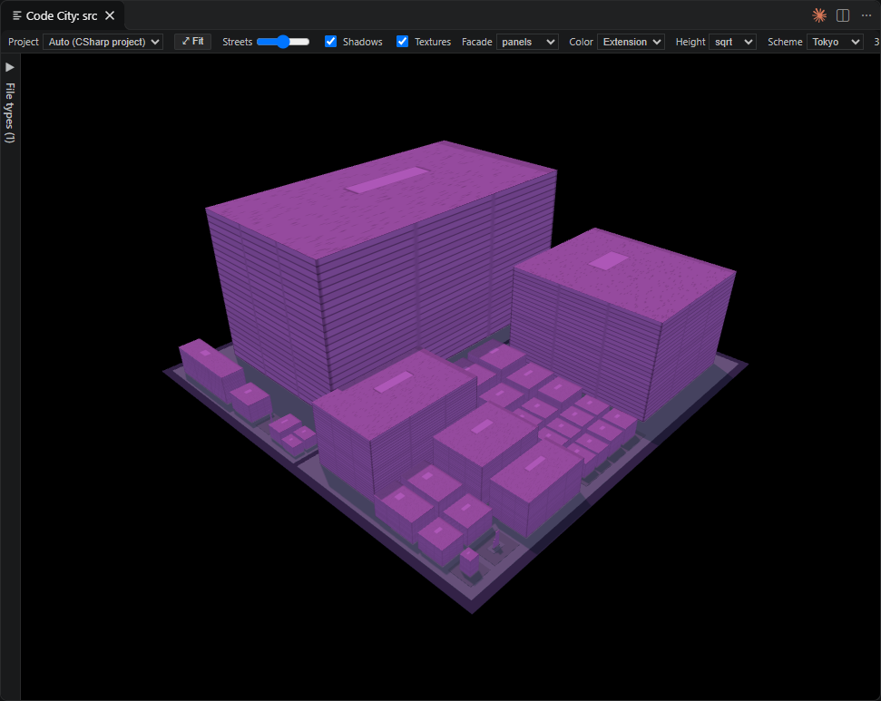
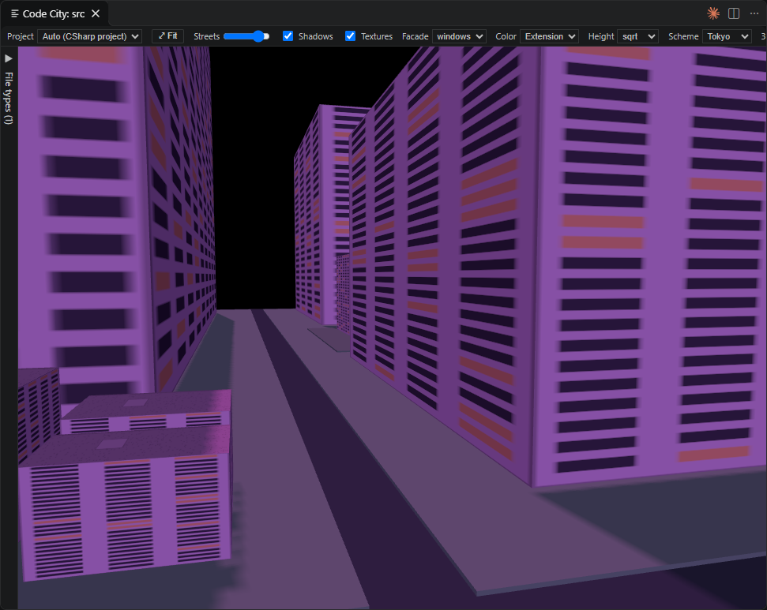

# Code City

VS Code extension that renders the open folder as a 3D city.

- Inspired by [Richard Wettel - CodeCity](https://wettel.github.io/codecity.html)
- **Folder → district** (nested plots, squarified treemap by LOC)
- **File → building** (height = lines of code; linear / sqrt / log scale)
- Color by LOC or by file extension; hover for path + lines; click to open the file.
- Procedural building textures (facade `windows` / `panels` / `neon` + rooftops, generated on a canvas — no image assets); toggle and style in the top bar.

## Usage

- Right-Click on root or subfolder in explorer, select "Code City: Show"
- Open command palette, select "Code City: Show"
- Top bar: **Textures** toggles the procedural facade/rooftop textures, **Facade** picks the style (`panels` default, `windows`, `neon`); **⤢ Fit** zooms out to best-fit the whole city from your current view direction (the city is auto-fitted when it first appears after a scan); **Copy** puts a PNG screenshot of the current view on the clipboard.
- Mouse: **left button + drag** turns (orbits) the city, **mouse wheel** zooms in and out, **right button + drag** pans (moves) the city; the camera keeps gliding briefly after you let go
- Mouse: hover a building to see its path and line count, **click** it to open the file in the editor

## Settings

- `Code City: Project Types`: The item is the project name, the value its file patterns separated by commas, e.g. *.cs, *.xaml, *.resx. Only files matching the active project's patterns are scanned. Patterns without a / match at any depth.
- `Code City: Ignored Folders`: Folder names to ignore at any depth, e.g. .git. Everything inside a folder with one of these names is skipped. * and ? wildcards work (e.g. cmake-build-*).
- `Code City: Exclude`: Additional glob patterns excluded from the city (applied together with codeCity.ignoredFolders).
- `Code City: Active Project`: Auto detects the project type from the files in the folder (the type matching the most files). Otherwise a project type name from codeCity.projectTypes, or All files to disable filtering.
- `Code City: Height Scale`: How lines of code map to building height. `linear/sqrt/log`
- `Code City: Max File Size KB`: Files larger than this are skipped.

## Theory

Based on the principles of Radu Marinescu’s paper, monitoring only file size (Lines of Code / LOC) and distribution across subdirectories (package structure/depth) allows you to draw the following conclusions:

### Detection of Potential God Classes

- __Indicator__: A single file within a subdirectory exhibits an exceptionally large file size compared to the rest of the project.
- __Conclusion__: This highly points to a violation of the Single Responsibility Principle. The class centralizes too many tasks, hoards lines of code (High LOC), and acts as a massive, hard-to-maintain monolith.

### Identification of Architectural Imbalances

- __Indicator__: A specific subdirectory contains disproportionately huge files, while other directories remain nearly empty or hold only tiny fragments.
- __Conclusion__: There is a misplacement of responsibilities in the system design. One subsystem bears the entire functional load, which often leads to compilation bottlenecks, testing delays, and frequent merge conflicts.

### Spotting Shotgun Surgery Tendencies (Wide Subsystems)

- __Indicator__: Extremely flat but heavily populated subdirectories (dozens or hundreds of files directly on the same hierarchy level).
- __Conclusion__: The subsystem suffers from high logical coupling. Functionality has been unnecessarily scattered across too many small files, meaning a single conceptual change forces developers to modify numerous files across that directory.

### Exposing Dead or Redundant Code

- __Indicator__: Subdirectories where file sizes stagnate completely over months, while neighboring directories grow dynamically.
- __Conclusion__: This indicates legacy or dead code. These components are structurally present but no longer contribute to the active evolution of the system, cluttering the overall architecture.

### The Limitation According to Marinescu

Marinescu emphasizes in his work that size and directory structure serve as excellent initial filters (symptom detectors) to isolate suspicious areas. However, to eliminate false positives, you must eventually combine them with internal design metrics—such as coupling (how much files interact with each other) and cohesion (whether the content inside a large file logically belongs together).

## References

- R. Marinescu. Detection strategies: Metrics-based rules for detecting design flaws. In ICSM 2004, pages 350–359. IEEE CS Press, 2004
- [Richard Wettel - CodeCity](https://wettel.github.io/codecity.html)