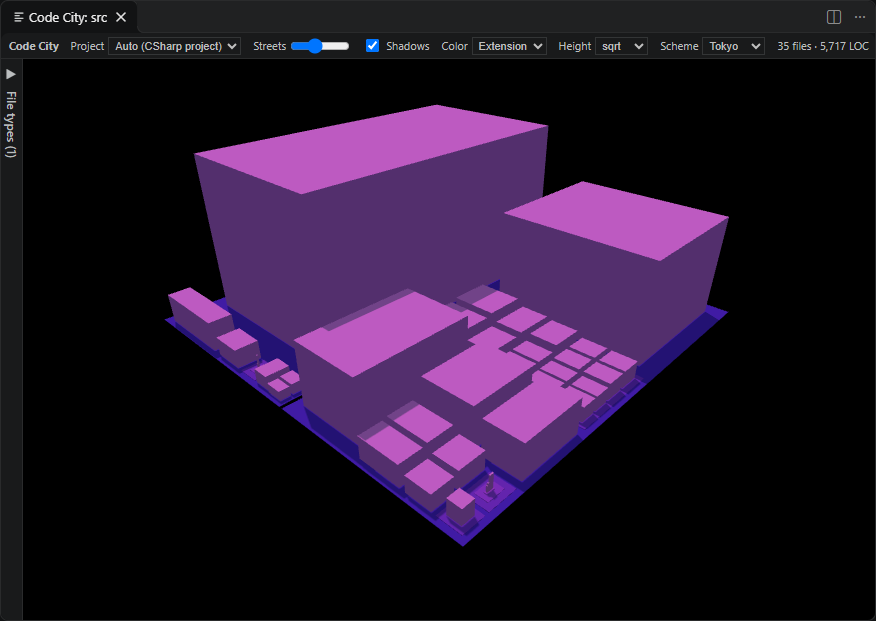

# Code City

VS Code extension that renders the open folder as a 3D city.

- **Folder → district** (nested plots, squarified treemap by LOC)
- **File → building** (height = lines of code; linear / sqrt / log scale)
- Color by LOC or by file extension; hover for path + lines; click to open the file.
- Procedural building textures (facade `windows` / `panels` / `neon` + rooftops, generated on a canvas — no image assets); toggle and style in the top bar.

## Usage

- Right-Click on root or subfolder in explorer, select "Code City: Show"
- Open command palette, select "Code City: Show"

## Settings

- `Code City: Project Types`: The item is the project name, the value its file patterns separated by commas, e.g. *.cs, *.xaml, *.resx. Only files matching the active project's patterns are scanned. Patterns without a / match at any depth.
- `Code City: Ignored Folders`: Folder names to ignore at any depth, e.g. .git. Everything inside a folder with one of these names is skipped. * and ? wildcards work (e.g. cmake-build-*).
- `Code City: Exclude`: Additional glob patterns excluded from the city (applied together with codeCity.ignoredFolders).
- `Code City: Active Project`: Auto detects the project type from the files in the folder (the type matching the most files). Otherwise a project type name from codeCity.projectTypes, or All files to disable filtering.
- `Code City: Height Scale`: How lines of code map to building height. `linear/sqrt/log`
- `Code City: Max File Size KB`: Files larger than this are skipped.

